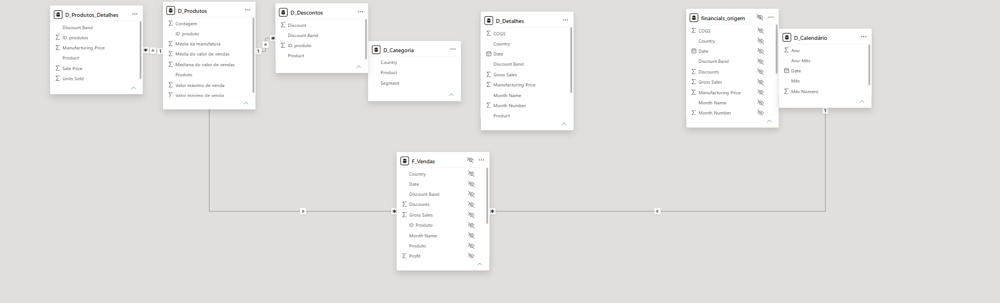

# Modelando um Dashboard de E-commerce com Power BI Utilizando Fórmulas DAX

Modelo em estrela construído no Power BI Desktop a partir da base **Financial Sample** (700 linhas de vendas, de setembro de 2013 a dezembro de 2014). A tabela única foi dividida em dimensões e uma fato, com calendário calculado em DAX.

Arquivo do modelo: [`Dashboard-de-E-commerce.pbix`](Dashboard-de-E-commerce.pbix)

## Esquema em estrela



A fato `F_Vendas` fica no centro. `D_Produtos` e `D_Calendário` filtram a fato. `D_Produtos_Detalhes` e `D_Descontos` detalham o produto e se ligam a `D_Produtos`, porque o produto não é único nessas tabelas. `D_Detalhes` e `D_Categoria` complementam o detalhe da venda e ficam sem relacionamento, para não criar relação muitos-para-muitos. `financials_origem` é a cópia de carga e permanece oculta na exibição de relatório.

## Etapas

1. A planilha `Sheet1` do Excel foi carregada no Power Query e a consulta foi nomeada `financials_origem`. A coluna ` Sales` (com espaço no início) foi renomeada para `Sales`.
2. As dimensões e a fato foram criadas como consultas que referenciam `financials_origem`, com colunas selecionadas, valores distintos e o índice de produto.
3. `Close & Apply` carregou as consultas no modelo.
4. A tabela `D_Calendário` foi criada com DAX, cobrindo o intervalo das vendas.
5. Os relacionamentos de chave única foram ativados na exibição de modelo.
6. `financials_origem` foi ocultada na exibição de relatório.
7. O diagrama foi organizado com a fato no centro e o print foi salvo em `prints/esquema-estrela.png`.

## Tabelas

### financials_origem

Backup da base original. Não entra no relatório.

### D_Produtos

Uma linha por produto. O `ID_produto` segue a regra do desafio:

| Produto | ID_produto |
| --- | --- |
| Carretera | 0 |
| Montana | 1 |
| Paseo | 2 |
| Velo | 3 |
| VTT | 4 |
| Amarilla | 5 |

Agrupamentos por produto:

| Coluna | Cálculo |
| --- | --- |
| Contagem | soma de Units Sold |
| Valor mínimo de venda | mínimo de Sale Price |
| Valor máximo de venda | máximo de Sale Price |
| Média do valor de vendas | média de Sale Price |
| Mediana do valor de vendas | mediana de Sale Price |
| Média da manufatura | média de Manufacturing Price |

### D_Produtos_Detalhes

Combinações distintas de produto, faixa de desconto, preço de venda, unidades e preço de manufatura, com `ID_produtos` vindo de `D_Produtos`.

### D_Descontos

Combinações distintas de produto, valor de desconto e faixa de desconto, com `ID_produto`.

### D_Detalhes

Detalhe da venda que não cabe nas outras dimensões: segmento, país, faixa de desconto, preço de manufatura, vendas brutas, COGS, lucro e a data com mês e ano.

### D_Categoria

Combinações distintas de país, produto e segmento.

### F_Vendas

Fato no grão da linha de venda. `SK_ID` começa em 1. Colunas: `SK_ID`, `ID_Produto`, `Produto`, `Units Sold`, `Sales Price`, `Discount Band`, `Segment`, `Country`, `Sales`, `Gross Sales`, `Discounts`, `Profit`, `Date` e `Month Name`.

### D_Calendário

Tabela calculada. Uma linha por dia entre 1º de setembro de 2013 e 1º de dezembro de 2014, com ano, mês, número do mês, trimestre e ano-mês.

## Relacionamentos

Todos ativos, cardinalidade muitos para um e filtro em direção única:

| De | Para |
| --- | --- |
| F_Vendas[ID_Produto] | D_Produtos[ID_produto] |
| F_Vendas[Date] | D_Calendário[Date] |
| D_Produtos_Detalhes[Product] | D_Produtos[Produto] |
| D_Descontos[Product] | D_Produtos[Produto] |

## Funções DAX

O calendário foi criado na barra de fórmulas da exibição de modelo, com separador de lista em vírgula:

```dax
D_Calendário =
ADDCOLUMNS (
    CALENDAR ( DATE ( 2013, 9, 1 ), DATE ( 2014, 12, 1 ) ),
    "Ano", YEAR ( [Date] ),
    "Mês Número", MONTH ( [Date] ),
    "Mês", FORMAT ( [Date], "MMMM", "pt-BR" ),
    "Trimestre", "T" & FORMAT ( [Date], "Q" ),
    "Ano-Mês", FORMAT ( [Date], "YYYY-MM" )
)
```

| Função | Papel neste modelo |
| --- | --- |
| `CALENDAR` | Gera a lista contínua de datas do período. |
| `DATE` | Fixa o primeiro e o último dia do calendário. |
| `ADDCOLUMNS` | Inclui ano, mês, trimestre e ano-mês em cada data. |
| `YEAR` | Extrai o ano. |
| `MONTH` | Extrai o número do mês. |
| `FORMAT` | Escreve o nome do mês em português, o trimestre e o ano-mês. |

## Como abrir

1. Abra `Dashboard-de-E-commerce.pbix` no Power BI Desktop.
2. Use a exibição de modelo para ver o esquema e a exibição de tabela para conferir os dados.
3. A base original está em `dataset/Financial Sample.xlsx`.
